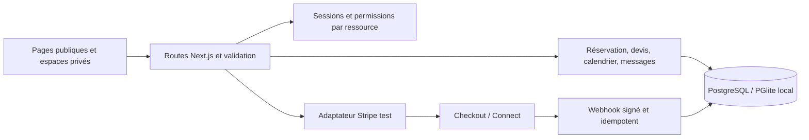

# Maisonnée — cadrage produit et architecture

État de travail au 13 octobre 2026. Le nom Maisonnée est une proposition ; disponibilité de marque et de domaine non vérifiée. Ce document distingue la cible commerciale du périmètre effectivement livré, détaillé dans [RECETTE.md](RECETTE.md).

## Diagnostic initial

Le dossier fourni ne contenait ni application, ni dépôt métier, ni dépendances, ni base de données, ni tests. Il contenait un cahier des charges très complet. Il n'existait donc aucun parcours à réparer ou à conserver. Aucun compte Stripe, hébergeur, domaine, prestataire d'e-mail, justificatif de chef, entreprise exploitante ou contrat n'a été fourni. Une ouverture commerciale ne peut pas être déduite de la réussite d'une démonstration locale.

La priorité est une tranche verticale persistante : découvrir un chef → choisir un menu → demander une réservation → réponse du chef → paiement vérifié → suivi. Les espaces client, chef et administrateur utilisent les mêmes enregistrements. Les services externes absents doivent être indisponibles de façon explicite, sans fausse confirmation.

## Vision et besoins

Maisonnée met en relation des particuliers et de jeunes professionnels de la cuisine pour des repas à domicile. Lancement pilote à Paris et en Île-de-France, expansion conditionnée à l'offre réellement disponible. La sélection valorise le talent et le parcours sans prétendre qu'un diplôme ou un statut étudiant autorise à lui seul une activité commerciale.

| Personne | Besoin prioritaire | Critère de réussite |
| --- | --- | --- |
| Client | Trouver une offre compréhensible et réserver avec confiance | Prix total et conditions connus avant engagement ; demande visible après reconnexion |
| Chef | Présenter son travail et gérer ses demandes | Une seule disponibilité vendue ; menu et prix contractés préservés |
| Administrateur | Publier une offre contrôlée et traiter les incidents | Actions autorisées, tracées, sans transformation arbitraire d'une réservation en paiement |
| Exploitant | Éviter une croissance déficitaire | GMV, commission, frais, remboursements, support et acquisition séparés |

## Architecture retenue

Monolithe modulaire Next.js App Router, React et TypeScript strict. Les composants de présentation appellent des routes internes ; celles-ci appliquent authentification, autorisation par objet et validation serveur avant les services métier. La base contient la source de vérité. Les prix transmis par le navigateur ne font pas autorité.



### Choix et écarts à la stack de référence

| Élément | Décision | Motif et limite |
| --- | --- | --- |
| Framework | Next.js + React + TypeScript | Routage public/privé et API dans un seul projet maintenable |
| Base locale | PostgreSQL embarqué PGlite | Exécution locale sans installation d'un serveur PostgreSQL ; persistance sur disque ; un seul processus propriétaire |
| Base de production | Adaptateur `pg`, schéma SQL PostgreSQL | Serveur PostgreSQL managé requis ; migration et validation sur cet environnement encore nécessaires |
| Accès aux données | Requêtes SQL paramétrées, sans Prisma | Réduction de la chaîne de génération et maîtrise explicite des transactions ; tests SQL indispensables |
| Authentification | Sessions serveur et hachage de mots de passe | Parcours local utilisable ; revue de sécurité, récupération e-mail et MFA admin sont des conditions de lancement |
| Paiement | Adaptateur Stripe Connect en mode test seulement | Aucune clé live acceptée ; clé manquante → indisponibilité claire, jamais succès artificiel |
| Notification | Données internes de notification | Aucune délivrabilité d'e-mail ou de SMS ne peut être revendiquée sans fournisseur configuré |
| Médias | Fichiers de démonstration locaux | Stockage privé, analyse et URLs signées nécessaires avant dépôt de pièces ou photos utilisateurs |
| Carte | À différer | Recherche par zone pilote utile avant dépendance et coût de géocodage |
| CMS, parrainage, calendriers tiers | À différer | Valeur inférieure aux transactions fiables pour le lancement |

Le schéma SQL est la référence des entités réellement implémentées. Toutes les entités du cahier des charges ne sont pas présumées présentes. Une extension ne doit jamais effacer les historiques financiers pour supprimer un compte.

### Invariants métier

- Monnaie EUR, montants entiers en centimes ; taux en points de base.
- Commission initiale de 1 000 points de base, soit 10 %. Le devis fige la règle utilisée.
- Un changement de menu, de prix ou de commission ne réécrit pas une réservation antérieure.
- La réservation et son état financier sont distincts. Un retour navigateur depuis Checkout ne prouve pas le paiement.
- Les événements externes sont vérifiés et dédupliqués ; une administration ne fabrique pas un versement.
- Le chef n'accède qu'aux prestations et échanges qui le concernent ; un client aux siens.
- Les profils de démonstration sont identifiés comme fictifs. Aucun faux avis ne constitue une preuve sociale commerciale.

## Arborescence produit

Les chemins marqués « cible » ci-dessous sont une intention de produit ; la liste des routes présentes dans le code et leur couverture sont dans la recette.

```text
/                          Accueil, recherche, découverte
/chefs                     Recherche et filtres
/chefs/[slug]              Profil, menus, réservation
/devenir-chef              Présentation et candidature
/connexion                 Connexion et inscription
/espace-client             Réservations, favoris, conversations
/espace-chef               Profil, menus, disponibilités, demandes
/admin                     Contrôle, commissions, incidents
/aide                      FAQ et contact
/mentions-legales          Éditeur et hébergeur à renseigner
/confidentialite           Information vie privée
/conditions                Contrats et annulations à valider
```

Cible complémentaire : récupération de compte, vérification d'e-mail, page d'appareils/sessions, centre de notifications, pages locales et éditoriales, gestion des factures, dossier de litige et CMS. Ne publier de page locale que lorsqu'une offre réelle existe.

## Matrice de permissions cible

Les permissions sont vérifiées côté serveur et au niveau de chaque ressource. Le statut administrateur n'est jamais un choix libre dans l'inscription. Un compte chef reste autorisé à réserver en tant que client, hors ses propres offres.

| Action | Visiteur | Client | Chef concerné | Administrateur |
| --- | --- | --- | --- | --- |
| Lire un profil approuvé et ses menus publics | Oui | Oui | Oui | Oui |
| Voir une adresse privée | Non | Sa réservation | Réservation attribuée et besoin de prestation | Besoin d'assistance légitime |
| Ajouter/supprimer un favori | Non | Le sien | Le sien comme client | Pas au nom d'autrui |
| Demander une prestation | Non | La sienne | Comme client | Pas de paiement forcé |
| Accepter/refuser une demande | Non | Non | Sa demande | Seulement selon procédure tracée |
| Modifier profil/menu/disponibilité | Non | Non | Les siens | Modération tracée |
| Lire/envoyer un message | Non | Conversation participante | Conversation participante | Accès support motivé à encadrer |
| Publier un avis | Non | Prestation éligible et unique | Pas sur sa propre offre | Modérer, pas inventer |
| Publier/suspendre un chef | Non | Non | Non | Oui, après contrôle |
| Modifier une commission | Non | Non | Non | Historisée, pour devis futurs |
| Initier remboursement | Non | Demande seulement | Demande seulement | Politique approuvée + permission |
| Marquer arbitrairement « payé » | Non | Non | Non | Non |
| Exporter toutes les données | Non | Export personnel cible | Export personnel cible | Minimisation et journalisation |

## Direction artistique et règles UX

Univers chaleureux : ivoire, vert profond, noir doux et accent cuivre ; titres éditoriaux expressifs, texte lisible, photographie culinaire dominante. La direction cherche la confiance d'une maison gastronomique accessible. Les tokens, espacements, boutons, cartes, champs, badges, états vides et erreurs sont centralisés dans les styles et composants du projet.

Le contraste, le clavier, les libellés, les erreurs associées aux champs et la visibilité du focus font partie de la recette. Respecter `prefers-reduced-motion`. Les valeurs WCAG AA et Core Web Vitals du brief sont des objectifs ; elles ne constituent pas des certifications acquises sans mesures.

### Parcours client

1. Saisir une zone, une date et un nombre de convives, puis consulter des résultats lisibles.
2. Comparer un profil et un menu ; comprendre le prix par convive, le total, les contraintes et le caractère de démonstration le cas échéant.
3. Se connecter en conservant le contexte ; fournir seulement les informations nécessaires à la prestation.
4. Lire le récapitulatif et envoyer la demande ; retrouver son état et l'historique dans son espace.
5. Attendre l'acceptation du chef ; payer uniquement dans Checkout configuré ; voir « confirmé » uniquement après preuve serveur.
6. Échanger dans la conversation liée à la réservation ; accéder au support et aux règles d'annulation.
7. Après prestation éligible, laisser un avis unique et pouvoir réserver à nouveau.

### Parcours chef et administrateur

Le chef renseigne son profil, ses menus et ses disponibilités puis demande publication. L'administrateur examine les éléments professionnels avant d'approuver. Le chef consulte les demandes dans sa propre interface et peut accepter ou refuser ; le client retrouve immédiatement ce changement. Les montants prévus doivent rester distingués des versements Stripe effectivement reçus.

L'administrateur traite publication, commission et support depuis des vues protégées. Il conserve les preuves et le motif d'une action sensible. Le contrôle de documents, le traitement comptable et les dossiers de litige ne sont pas déclarés automatisés lorsqu'ils nécessitent encore une intervention humaine.

## Ordre de réalisation et jalons

| Phase | Livrable | Sortie attendue |
| --- | --- | --- |
| Fondations | Modèle, sessions, données seed, pages et design | Types et build valides ; accès privés refusés |
| Offre | Profils, menus, calendrier, validation | Offre publiée issue de la base ; prix figés à la réservation |
| Demande | Recherche, favoris, réservation, espaces | Une demande traversant les trois espaces, persistante |
| Transaction | Connect, Checkout, webhook, refund | Signatures et doublons testés ; recette Stripe externe nécessaire |
| Communication | Messages, notifications, support | Historique persistant et participants autorisés |
| Préouverture | Juridique, vraie offre, e-mails, MFA, exploitation | Preuves et autorisation humaine explicite |

### MVP commercial, V1 et V2

**MVP commercial à clôturer avant ouverture** : tranche transactionnelle, données réelles validées, information contractuelle, e-mails essentiels, récupération de compte, MFA administrateur, supervision, sauvegardes restaurables et recette Stripe test complète. Le code local peut avancer sans que ce jalon soit acquis.

**V1 après validation commerciale** : filtres plus fins, carte de zones approximatives, SEO local utile, calendrier externe, analytics consentis, promotions dont le financeur est identifié, support automatisé. Favoris et avis peuvent être présents en avance, sans changer la priorité du lancement.

**V2 sous condition de rentabilité** : parrainage, entreprise, fidélité, recommandations avancées, instant booking, abonnements, internationalisation et éventuelle application mobile.

## Modèle économique

`src/lib/economics.ts` calcule une projection mensuelle pure et paramétrable, avec tests. Les paramètres des trois scénarios sont des hypothèses de planification datées du 13/10/2026, **pas des prix Stripe ni un prévisionnel garanti**. Le calcul conserve les frais du paiement initial en cas de remboursement, restitue proportionnellement la commission et compte le support sur toutes les réservations payées projetées. Il modélise un seul panier moyen et un mélange de clients acquis/récurrents ; cohortes et saisonnalité restent à ajouter.

GMV = chefs × réservations par chef × panier. Commission nette projetée = commission brute moins commission remboursée. Marge contributive = commission nette moins paiement, support et acquisition. Résultat de scénario = marge contributive moins technique et charges fixes. Ce dernier n'est pas un bénéfice comptable : TVA, fiscalité, rémunération complète des fondateurs, besoin en trésorerie, impayés et litiges exceptionnels ne sont pas automatiquement modélisés.

| Hypothèse mensuelle | Prudent | Central | Optimiste |
| --- | ---: | ---: | ---: |
| Chefs × réservations | 15 × 2 | 30 × 4 | 60 × 6 |
| Panier moyen | 320 € | 480 € | 620 € |
| Commission | 10 % | 10 % | 10 % |
| Part remboursée intégralement | 12 % | 7 % | 4 % |
| Frais paiement hypothétiques | 1,8 % + 0,25 € | 1,8 % + 0,25 € | 1,8 % + 0,25 € |
| Support / réservation | 8 € | 6 € | 4 € |
| Part nouvellement acquise ; CAC | 60 % ; 40 € | 40 % ; 35 € | 25 % ; 25 € |
| Technique ; charges fixes | 150 € ; 2 000 € | 150 € ; 2 000 € | 250 € ; 3 500 € |

Mesurer le CAC par canal avec des coûts réels ; ne pas financer une promotion avant calcul de sa marge après remboursements. Une commission de 10 % impose une attention particulière au panier et au réachat.
